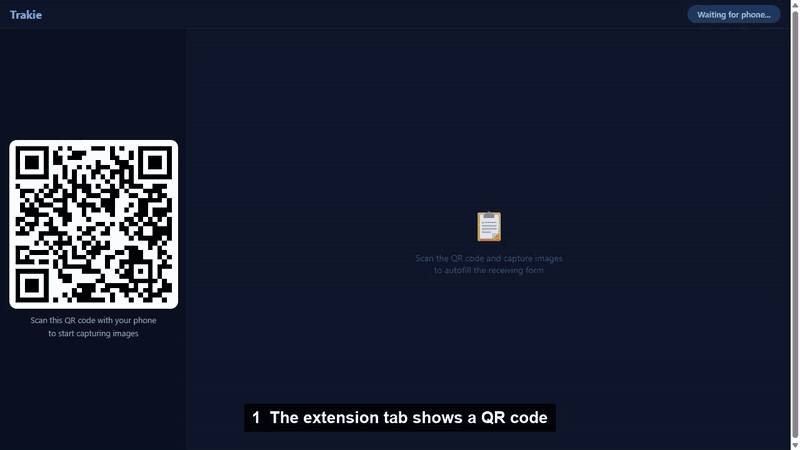

# Trakie Prototype



*Recorded on a local stack: the server, the loaded extension and an emulated phone, with a local vision model (Qwen3.5 9B on Ollama) doing the reading. The invoice and label are made-up samples (`docs/sample/`).*

Prototype of the core Trakie flow. A dispensary worker scans a QR code on their desktop, captures invoice and label photos on their phone, and the receiving form fills itself. Built for the vault room at 9am with three deliveries waiting.

## Architecture

Three components connected via WebSocket:

- **Chrome Extension** - Opens a new tab with a QR code and a 16-field receiving form
- **Node.js/Express + Socket.IO Server** - WebSocket hub and vision processing through an OpenAI-compatible API
- **Mobile Capture Page** - Served by the server, accessed by scanning the QR code

```
Phone (camera) --> Socket.IO --> Server (vision model) --> Socket.IO --> Extension (form autofill)
```

## How It Works

1. Extension opens a new tab with a QR code and an empty form
2. Phone scans the QR code and loads the mobile capture page
3. Socket.IO room links phone and desktop via a unique session token
4. Phone captures invoice/label photos (camera or gallery), up to 5 per session
5. Images compressed client-side and sent via WebSocket with ack callbacks
6. Server receives images, stores in memory
7. Images sent to the vision model (OpenAI o4-mini by default) with structured function calling
8. The model extracts all products from the invoice, matches labels by batch number, and scores each field's confidence (HIGH / MEDIUM / NEEDS_REVIEW)
9. Results pushed to desktop, fields autofill with animation and confidence colors
10. The clerk reviews, fixes what is wrong and confirms each product. Required fields (product name, brand, category, vendor, quantity) block the confirm until filled, and prices must be numeric

## Form Fields (16)

| Section | Fields |
|---------|--------|
| Product Identity | Product Name, Brand, Category, Subcategory |
| Compliance | THC %, CBD %, Net Weight, Batch Number, Expiration Date, Package ID/METRC Tag |
| Pricing | Wholesale Cost, Retail Price |
| Product Details | Ingredients, Allergens |
| Receiving | Vendor Name, Quantity Received |

## Tech Stack

| Layer | Technologies |
|-------|-------------|
| Server | Node.js, Express, Socket.IO 4.x, OpenAI SDK (o4-mini by default, any OpenAI-compatible vision endpoint works) |
| Extension | Chrome Manifest V3, vanilla JS |
| Mobile | Vanilla HTML/JS, served by Express |
| Storage | None - session state in memory (prototype) |

## Setup

### Prerequisites

- Node.js 18+
- Chrome
- An OpenAI API key, or a local vision model (see below)

### Install and Run

```bash
cd server && npm install
cp ../.env.example ../.env  # the server reads .env from the repo root; add your OpenAI API key
npm start
```

| Variable | Default | What it does |
|----------|---------|--------------|
| `OPENAI_API_KEY` | none, required | Any non-empty value works for a local server that ignores keys |
| `OPENAI_BASE_URL` | OpenAI | Point at another OpenAI-compatible server, e.g. `http://localhost:11434/v1` |
| `OPENAI_MODEL` | `o4-mini` | Must accept images |
| `OPENAI_REASONING_EFFORT` | `high` | `none` turns thinking off on servers that support it |
| `OPENAI_TEMPERATURE` | not sent | o4-mini rejects it; set `0` for local models |
| `PORT` | `3000` | Server port |

### Load the Extension

1. Navigate to `chrome://extensions`
2. Enable Developer mode
3. Click "Load unpacked" and select the `extension/` folder
4. Click the Trakie icon, then "Open Trakie"

### Point the Extension at the Server

The tab connects to `http://localhost:3000` by default. To use another address, open the tab once as `chrome-extension://<extension id>/tab.html?server=http://<address>:<port>`. The address is remembered. The QR code encodes the same address, so for a real phone it has to be your machine's LAN address (for example `http://192.168.x.x:3000`) on the same network as the phone.

### Try It With the Sample Photos

`docs/sample/invoice.jpg` (two line items) and `docs/sample/label.jpg` (a label for the first one only) are made-up documents. Open the phone page, add both with "Upload Image" and send them.

### Run It on a Local Model (no API key)

This is how the demo above was recorded. It needs a vision-capable model. On Ollama that means a model whose `ollama show` lists `vision`, for example `qwen3.5:9b`.

Ollama's default context window (4096 tokens) is too small for two images plus the prompt, so create a variant first:

```
FROM qwen3.5:9b
PARAMETER num_ctx 16384
```

```bash
ollama create trakie-local -f Modelfile
```

Then in `.env`:

```
OPENAI_API_KEY=ollama
OPENAI_BASE_URL=http://localhost:11434/v1
OPENAI_MODEL=trakie-local
OPENAI_REASONING_EFFORT=none
OPENAI_TEMPERATURE=0
```

With thinking left on, the 9B model spent its whole token budget reasoning and returned no result. With it off, a two-photo run takes about 5 seconds on an RTX 5070 Ti.

**What to expect from a small local model.** It reads the documents but is not as careful as the model this prompt was written for. In the recording every field shows MEDIUM, because the model returns bare values with no confidence and the server marks those MEDIUM. It also put the invoice line total in Retail Price, and for the product that had no label photo it invented an expiry date, a barcode, ingredients and allergens. The recording shows the clerk clearing those before confirming. That review step is the reason the form exists. The extraction accuracy of the default o4-mini setup was not re-measured here.

## Technical Decisions

**o4-mini over a separate OCR service** - I originally considered piping Google Cloud Vision or Textract into an LLM for structuring. But o4-mini with function calling handles both reading and structuring in one pass. Tested a few vision models on the provided images and this was the most accurate on dense, rotated label text. Simpler pipeline, fewer failure points.

**Socket.IO rooms for pairing** - Each QR scan creates a session token. Phone and desktop join the same room. Same pattern as WhatsApp Web. Clean isolation without authentication for a prototype.

**Structured function calling** - The model returns typed JSON with all 16 fields and confidence levels through OpenAI's function calling with a strict schema. No free-text parsing; the only post-processing is small normalisation (spaces stripped from the package ID, a `$` added to the cost). Servers that do not enforce the schema can return bare strings, nulls or missing keys, so every product is normalised to the 16 fields and anything missing is flagged NEEDS_REVIEW.

**Client-side compression** - Images are resized to 2048px max and re-encoded as JPEG before upload so we're not pushing full-resolution photos over the WebSocket. Production would use presigned S3 URLs instead of base64.

**Multi-product extraction** - The model extracts all line items from an invoice and matches label photos to the corresponding product by batch number. Products without a matching label get invoice fields filled and compliance fields flagged for manual entry. That is what the prompt asks for; small models do not always follow it (see above).

## Limitations

- The server address is set per browser with `?server=` (default `http://localhost:3000`); a phone needs the LAN address and the same network
- The demo was recorded with an emulated phone, not a physical one. The on-screen QR was decoded and resolves to the phone page with the live session token
- No persistent storage - data lost on server restart
- No authentication - session tokens only
- No field validation beyond the required fields and numeric prices - prototype scope
- Single server, no horizontal scaling
