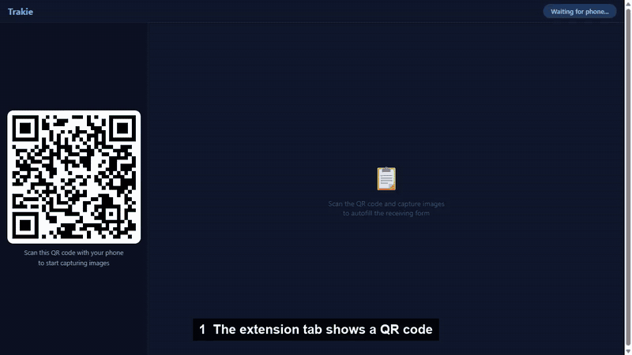

# Trakie Prototype

[](https://github.com/Exalt24/trakie-prototype/actions/workflows/ci.yml)



*Recorded on a local stack: the server, the loaded extension and an emulated phone, with a local vision model (Qwen3.5 9B on Ollama) doing the reading.*

*The invoice and label are sample documents (`docs/sample/`).*

Chrome extension that pairs with a phone by QR so invoice photos fill a desktop receiving form via a vision model.

A dispensary worker scans a QR code on their desktop, captures invoice and label photos on their phone, and the receiving form fills itself. Built for the vault room at 9am with three deliveries waiting.

## Architecture

Three components connected via WebSocket:

- **Chrome Extension**: opens a new tab with a QR code and a 16-field receiving form.
- **Node.js/Express + Socket.IO Server**: WebSocket hub and vision processing through an OpenAI-compatible API.
- **Mobile Capture Page**: served by the server, accessed by scanning the QR code.

```
Phone (camera) --> Socket.IO --> Server (vision model) --> Socket.IO --> Extension (form autofill)
```

## How It Works

1. Extension opens a new tab with a QR code and an empty form.
2. Phone scans the QR code and loads the mobile capture page.
3. Socket.IO room links phone and desktop via a unique session token.
4. Phone captures invoice/label photos (camera or gallery), up to 5 per session.
5. Images compressed client-side and sent via WebSocket with ack callbacks.
6. Server receives images, stores in memory.
7. Images sent to the vision model (OpenAI o4-mini by default) with structured function calling.
8. The model extracts all products from the invoice and matches labels by batch number. It scores each field's confidence (HIGH / MEDIUM / NEEDS_REVIEW).
9. Results pushed to desktop, fields autofill with animation and confidence colors.
10. The clerk reviews, fixes what is wrong and confirms each product. Required fields (product name, brand, category, vendor, quantity) block the confirm until filled. Prices must be numeric.

## Form Fields (16)

| Section | Fields |
|---------|--------|
| Product Identity | Product Name, Brand, Category, Subcategory |
| Compliance | THC %, CBD %, Net Weight, Batch Number, Expiration Date, Package ID/METRC Tag |
| Pricing | Wholesale Cost, Retail Price |
| Product Details | Ingredients, Allergens |
| Receiving | Vendor Name, Quantity Received |

## Tech Stack

| Layer | Technologies |
|-------|-------------|
| Server | Node.js, Express, Socket.IO 4.x, OpenAI SDK (o4-mini by default, any OpenAI-compatible vision endpoint works), AWS SDK v3 for S3 presigned uploads |
| Extension | Chrome Manifest V3, vanilla JS |
| Mobile | Vanilla HTML/JS, served by Express |
| Storage | Session state in memory (prototype). Optional S3-compatible object storage carries the photos in transit |

## Setup

### Prerequisites

- Node.js 20+ (22 to run the tests)
- Chrome
- An OpenAI API key, or a local vision model (see below)

### Install and Run

```bash
cd server && npm install
cp ../.env.example ../.env  # the server reads .env from the repo root; add your OpenAI API key
npm start
```

| Variable | Default | What it does |
|----------|---------|--------------|
| `OPENAI_API_KEY` | none, required | Any non-empty value works for a local server that ignores keys |
| `OPENAI_BASE_URL` | OpenAI | Point at another OpenAI-compatible server, e.g. `http://localhost:11434/v1` |
| `OPENAI_MODEL` | `o4-mini` | Must accept images |
| `OPENAI_REASONING_EFFORT` | `high` | `none` turns thinking off on servers that support it |
| `OPENAI_TEMPERATURE` | not sent | o4-mini rejects it; set `0` for local models |
| `PORT` | `3000` | Server port |

### Load the Extension

1. Navigate to `chrome://extensions`
2. Enable Developer mode
3. Click "Load unpacked" and select the `extension/` folder
4. Click the Trakie icon, then "Open Trakie"

### Point the Extension at the Server

The tab connects to `http://localhost:3000` by default. To use another address, open the tab once as `chrome-extension://<extension id>/tab.html?server=http://<address>:<port>`. The address is remembered. The QR code encodes the same address. For a real phone it has to be your machine's LAN address (for example `http://192.168.x.x:3000`) on the same network as the phone.

### Try It With the Sample Photos

`docs/sample/invoice.jpg` (two line items) and `docs/sample/label.jpg` (a label for the first one only) are sample documents. Open the phone page, add both with "Upload Image" and send them.

### Run It on a Local Model (no API key)

This is how the demo above was recorded. It needs a vision-capable model. On Ollama that means a model whose `ollama show` lists `vision`, for example `qwen3.5:9b`.

Ollama's default context window (4096 tokens) is too small for two images plus the prompt, so create a variant first:

```
FROM qwen3.5:9b
PARAMETER num_ctx 16384
```

```bash
ollama create trakie-local -f Modelfile
```

Then in `.env`:

```
OPENAI_API_KEY=ollama
OPENAI_BASE_URL=http://localhost:11434/v1
OPENAI_MODEL=trakie-local
OPENAI_REASONING_EFFORT=none
OPENAI_TEMPERATURE=0
```

With thinking left on, the 9B model spent its whole token budget reasoning and returned no result. With it off, a two-photo run takes about 5 seconds on an RTX 5070 Ti.

**What to expect from a small local model.** It reads the documents but is not as careful as the model this prompt was written for. In the recording every field shows MEDIUM. The model returns bare values with no confidence, and the server marks those MEDIUM. It also put the invoice line total in Retail Price. For the product that had no label photo it invented an expiry date, a barcode, ingredients and allergens. The recording shows the clerk clearing those before confirming. That review step is the reason the form exists. The extraction accuracy of the default o4-mini setup was not re-measured here.

## Local OCR engine (Tesseract, no model)

Set `TRAKIE_OCR_ENGINE=tesseract` and the server reads invoice photos with Tesseract (`tesseract.js` and the `@tesseract.js-data/eng` language data, both from npm) instead of calling a vision model. It needs no API key and no network. `server/local-ocr.js` turns the recognised text into the same 16 fields, so the extension and the form do not change.

- It reads the invoice table: vendor (from "Sold By"), product, batch (the code in parentheses), quantity, price, and the date and Total Due.
- A field is HIGH only when Tesseract's mean confidence for the page is 70 or more, quantity times price equals the row total, and the row totals add up to Total Due. Anything else is MEDIUM, so the clerk looks.
- It does not read product labels. Brand, category, potency, ingredients, allergens and expiry stay empty and flagged NEEDS_REVIEW. Package ID is 0, the same rule as the vision prompt.
- A photo with no table rows gives the same "No products detected" error as the model path.

One recorded run on 2026-11-10 (Node 24, tesseract.js 7.0.0, English data, 0.4 s for the page) on `docs/sample/invoice.jpg`:

```
engine_confidence 87, date 10/08/2026, total_due 338.00, total_ties true, rows 2
Pinecrest Berry Gummies 10mg      | batch PCB-2204-17 | 20 ea / 1 case | $8.50  | HIGH
Pinecrest Mint Chocolate Bar 100mg| batch PCB-2231-09 | 12 ea / 1 case | $14.00 | HIGH
vendor: Pinecrest Botanicals LLC (MEDIUM)
```

The invoice number `INV-20417` in the bold corner heading was not read (Tesseract returned `0 oa`), so that value is empty and not guessed. A second fixture, `tests/invoice-harbor.png` (three rows, a plain text layout drawn by `tests/make-invoice-fixture.py`), reads all three rows too.

**Tests.** `server/tests/local-ocr.test.js` has 14 tests: the parser on known text, a generated table of bad inputs that each turn one check red (with a passing control row), real OCR on both images, two photos in one session, a blank image, the engine switch, and the server run as a child process with a phone photo sent over Socket.IO. `node tests/mutants.mjs --suite local-ocr` removes one check at a time (row arithmetic, the Total Due sum, the confidence floor, the HIGH rule, the label-field flag, the empty-result error, reading every photo, the vendor stop, the engine name check) and caught 9 of 9. It needs no container.

**Limits.** It was run on two clean, printed, generated invoices, not on phone photos with glare or rotation, and not in production. It reads one layout family (a row of name, batch in parentheses, quantity, price, total). The vision path stays the default and is the one that reads labels.

## Direct to object storage

Set `S3_BUCKET` and the phone stops sending photos through the WebSocket. For each photo it asks the server for a presigned URL (`request-upload-url`). It PUTs the compressed JPEG straight to the bucket, then tells the server it is there (`image-uploaded`). The server fetches the object and runs the same code as the base64 path (progress events, the processing guard, the vision call). It deletes the session's objects once the result or the error is out, or when the desktop leaves. With `S3_BUCKET` unset nothing changes. The join reply says `uploads: "socket"` and the phone sends base64 as before.

What the server checks before it signs and before it reads:

- The token is 32 hex characters, the index is 0 to total minus 1, total is 1 to 10, the type is JPEG, PNG or WebP, the size is 1 byte to 10 MB (`server/uploads.js`).
- The URL signs Content-Type and Content-Length and expires in 300 seconds, so the store itself refuses another type or a body of another size.
- A key is accepted only as exactly `sessions/<this session's token>/<n>.jpg`. A traversal, another session's prefix or an extra segment is refused before the store is asked.
- Only the phone paired to the session can ask for a URL or report an upload.

| Variable | What it does |
|----------|--------------|
| `S3_BUCKET` | Turns the feature on. The bucket must exist |
| `S3_ENDPOINT` | Optional. Set it for MinIO or another S3-compatible store; path-style addressing is then used |
| `S3_REGION` | Optional, default `us-east-1` (or `AWS_REGION`) |
| `S3_FORCE_PATH_STYLE` | Optional, `1` forces path-style on a store without `S3_ENDPOINT` |
| `AWS_ACCESS_KEY_ID`, `AWS_SECRET_ACCESS_KEY`, `AWS_SESSION_TOKEN` | The only place credentials are read from |

Trying it against MinIO and the bucket CORS rule are in [docs/object-storage.md](docs/object-storage.md).

**Tests.** `cd server && npm test` runs the Node test runner. The MinIO tests skip with a message when nothing answers on `localhost:59000`. With `TRAKIE_REQUIRE_MINIO=1` (what CI sets) a missing container fails them instead. `node tests/mutants.mjs` removes one guard at a time in a temp copy and requires the suite to fail each time. Run on 2026-10-24 against MinIO `RELEASE.2026-08-04T00-00-00Z`:

| Part | Count |
|------|-------|
| Unit tests for `uploads.js` (generated table of bad tokens, indexes, totals, types, sizes and key shapes, with positive controls) | 127 |
| Storage tests against the MinIO container | 7 |
| Storage tests that need no container | 3 |
| End to end over Socket.IO against MinIO | 7 |
| End to end with the server as a child process (base64 path, production refusal) | 2 |
| Mutants removed one at a time and caught | 19 of 19 |

**Limits.**

- Tested on MinIO, which is S3-compatible. A signing detail or an error code could differ on AWS S3.
- Bucket CORS: the phone page was driven once in headless Chromium against the local server and MinIO. MinIO answers every origin, so a bucket CORS rule is the next thing to try on a hosted bucket.
- `TRAKIE_FAKE_OCR=1` swaps the vision call for a stub so the tests need no model. It is test-only and the server refuses to start with it when `NODE_ENV=production`.
- The stub OCR reports the byte count of the photos, so the end-to-end tests show that the bytes arrived.
- After a failed upload part way through, a retry sends only the photos the server has not counted. Changing the photo list between attempts is not handled.

## Technical Decisions

**o4-mini over a separate OCR service.** I originally considered piping Google Cloud Vision or Textract into an LLM for structuring. But o4-mini with function calling handles both reading and structuring in one pass. Tested a few vision models on the provided images and this was the most accurate on dense, rotated label text. Simpler pipeline, fewer failure points. A local Tesseract engine is also there for printed invoices (see Local OCR engine), because it needs no key and its arithmetic check can prove a row.

**Socket.IO rooms for pairing.** Each QR scan creates a session token. Phone and desktop join the same room. Same pattern as WhatsApp Web. Clean isolation without authentication for a prototype.

**Structured function calling.** The model returns typed JSON with all 16 fields and confidence levels through OpenAI's function calling with a strict schema. No free-text parsing. The only post-processing is small normalisation (spaces stripped from the package ID, a `$` added to the cost). Servers that do not enforce the schema can return bare strings, nulls or missing keys. So every product is normalised to the 16 fields, and anything missing is flagged NEEDS_REVIEW.

**Client-side compression.** Images are resized to 2048px max and re-encoded as JPEG before upload so we're not pushing full-resolution photos over the WebSocket. With S3-compatible storage configured, the phone skips base64. It uploads straight to the bucket with a presigned URL (see Direct to object storage). Without it, the base64 path is unchanged.

**Multi-product extraction.** The model extracts all line items from an invoice and matches label photos to the corresponding product by batch number. Products without a matching label get invoice fields filled and compliance fields flagged for manual entry. That is what the prompt asks for; small models do not always follow it (see above).

## Limitations

- The server address is set per browser with `?server=` (default `http://localhost:3000`). A phone needs the LAN address and the same network.
- The demo was recorded with an emulated phone, not a physical one. The on-screen QR was decoded and resolves to the phone page with the live session token.
- No persistent storage: data is lost on server restart (photos in an object store are deleted after each session).
- No authentication: session tokens only.
- No field validation beyond the required fields and numeric prices. That is prototype scope.
- Single server, no horizontal scaling.
